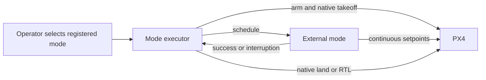
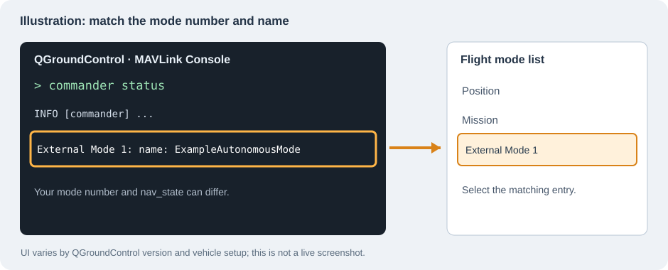
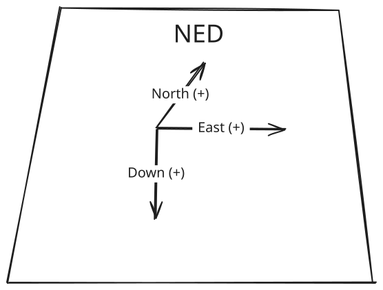

# External modes

PX4 external modes are flight modes implemented on a companion computer with ROS 2. They register with PX4 and appear alongside built-in modes in QGroundControl. Use one when the mission needs custom continuous control, such as following a target, while still letting PX4 manage mode selection, arming checks, and configured failsafes. The [PX4 ROS 2 Control Interface guide](https://docs.px4.io/v1.16/en/ros2/px4_ros2_control_interface) describes the registration and mode requirements.

An external **mode** sends setpoints while selected. A **mode executor** runs a state machine around it: arm, take off, schedule the mode, land or RTL, then wait for disarm. The executor is optional, but recommended for missions with several stages. Start with [`example_autonomous_mode`](../src/example_autonomous_mode/README.md) for an example of both classes. [`precision_land/BlankMode.cpp`](../src/precision_land/BlankMode.cpp) shows a mode without an executor; the pilot must arm and select it separately.

The mode needs a supported `px4_ros2` setpoint type, a unique registered name, and appropriate position or other vehicle inputs. Our example uses `OdometryLocalPosition` and `TrajectorySetpointType`. A mode can be selected by the operator, by another PX4 mechanism, or by its executor; registering the node alone does not start a mission. The [example state diagram](../src/example_autonomous_mode/README.md#how-the-pieces-fit) shows when the executor schedules the mode and takes over again for landing.

## Registration and message versions

The registered name is serialized into [`RegisterExtComponentRequest.name`](../src/px4_msgs/msg/RegisterExtComponentRequest.msg). PX4 uses a hash of the name to preserve an external mode's switch index across startup-order changes; see [Assigning a Mode to an RC Switch](https://docs.px4.io/v1.16/en/ros2/px4_ros2_control_interface#assigning-a-mode-to-an-rc-switch-or-joystick-action).

PX4 firmware, `px4_msgs`, and the interface library must agree on message definitions. This workspace uses the [PX4 message translation node](https://docs.px4.io/main/en/ros2/px4_ros2_msg_translation_node). For this checkout, call `setSkipMessageCompatibilityCheck()` in **both** the mode and executor constructors; the version check otherwise rejects registration. Skipping that check does not itself translate messages. Start the translation node as described in the [workspace setup](../README.md), and keep the message versions pinned to the versions used by this project.

## Setpoints and failsafes

The selected mode must keep publishing the setpoints required by its active control type. The interface library requests a timer rate (50 Hz by default), but actual timing varies. `updateSetpoint(float dt_s)` receives the measured interval; use it for motion integration. [PX4's setpoint configuration](https://docs.px4.io/main/en/msg_docs/SetpointConfig) defines a setpoint timeout, and registration/arming checks detect unresponsive modes. This differs from Offboard mode's `OffboardControlMode` proof-of-life stream.

If the active external mode crashes, stops responding, loses a required position estimate, or stops supplying setpoints, PX4 may enter its configured failsafe. The action depends on the aircraft's safety settings; it is not always an immediate disarm. A landing detector topic is not required to keep a mode alive. The example subscribes to `VehicleLandDetected` only to locate the ground for its optional controlled descent, then lets PX4's native landing handle touchdown and disarm. See [PX4 mode requirements and failsafes](https://docs.px4.io/v1.17/en/ros2/px4_ros2_control_interface#failsafes-and-mode-requirements).

## Finding the registered mode in QGroundControl

1. Launch the node and wait for successful registration.
2. Open QGroundControl's **MAVLink Console** and run `commander status`.
3. Find `External Mode N: nav_state: ..., name: ...` and match its name and number to the external-mode entry in the flight-mode selector or switch assignment.

PX4 local position uses the North-East-Down frame:

The positive z axis points down. Increasing altitude above the ground makes local NED z more negative; a positive z velocity commands descent. **Check** the requested frame and units whenever you add a new setpoint type.

## Adding a mode to this workspace

Copy both [`ExampleAutonomousMode.hpp`](../src/example_autonomous_mode/ExampleAutonomousMode.hpp) and [`ExampleAutonomousMode.cpp`](../src/example_autonomous_mode/ExampleAutonomousMode.cpp) into your ROS 2 package. Together they define the mode, executor, and node. The [setup instructions](../src/example_autonomous_mode/README.md#using-the-classes-in-another-package) cover renaming them and updating the build dependencies. To reuse the parameter setup, also copy [`cfg/example_autonomous_mode_params.yaml`](../src/example_autonomous_mode/cfg/example_autonomous_mode_params.yaml) and [`launch/example_autonomous_mode.launch.py`](../src/example_autonomous_mode/launch/example_autonomous_mode.launch.py). Keep `/drone_state` and `/tracking_error` if they're useful for debugging.

ROS 2 supports [Python, XML, and YAML launch files](https://docs.ros.org/en/humble/How-To-Guides/Launch-file-different-formats.html). We use Python here, but this launch file only needs to start a node and load its parameters. Keep it that simple unless you need more launch logic. XML or YAML would also work for this setup. The parameter YAML is a separate file whichever launch format you choose.
