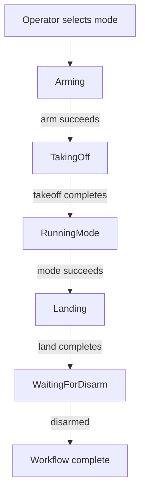
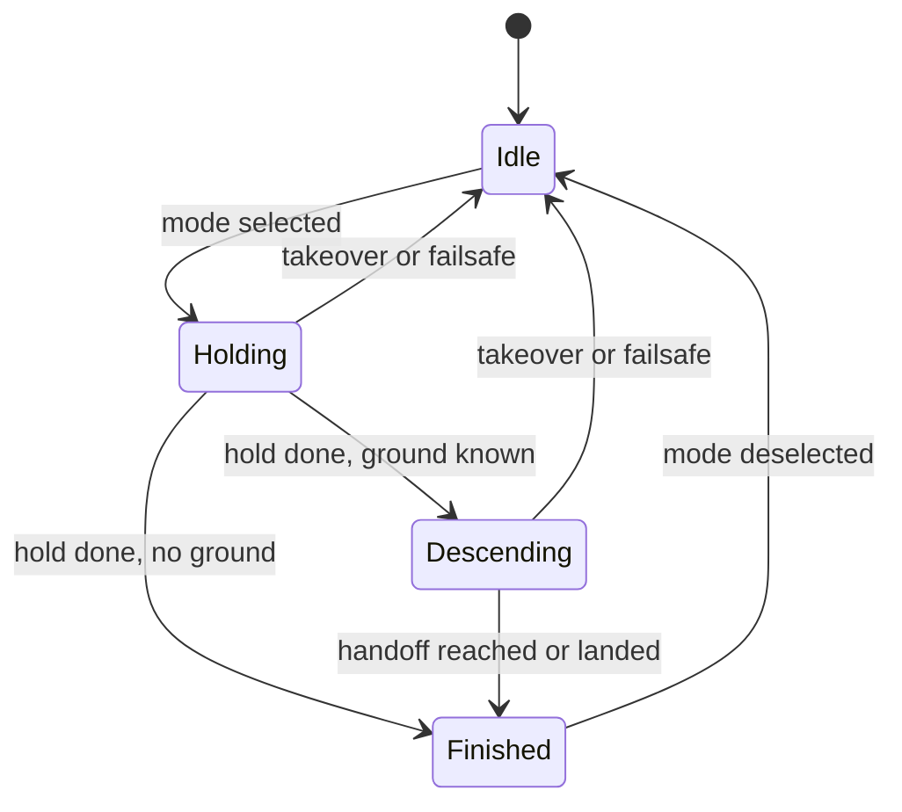

# Example autonomous mode

This example pairs a PX4 external mode with an executor. The executor arms, requests PX4's native takeoff, schedules the mode, requests native landing, then waits for PX4 to disarm. While scheduled, the mode holds position and makes a short controlled descent.

Start with [External Modes](../../general_docs/external_modes.md) if registration, setpoints, or mode executors are new to you. A simple mode can be selected by the pilot after takeoff. This example includes an executor because it needs to sequence PX4 operations around the custom setpoint behavior, like the drogue-flight workflow.

> Selecting this mode starts an automatic arm and takeoff. Try it in SITL first. For initial hardware integration, remove the propellers and keep a pilot ready to take over. Check PX4's configured native-takeoff altitude before flight.

## How the pieces fit

`ExampleAutonomousModeExecutor` calls `arm()`, `takeoff()`, `scheduleMode()`, `land()`, and `waitUntilDisarmed()` in order. `ExampleAutonomousMode` sends the NED setpoints for holding and descending. PX4 handles touchdown and disarming. If the mode ends because of a pilot takeover or failsafe, the executor leaves control there rather than requesting landing.

The executor sequences PX4 operations:



While scheduled, the mode runs these states:



The mode starts in `Idle` and returns there on `onDeactivate()`. It sends no setpoints while idle, including while the executor arms and takes off. Once scheduled, `onActivate()` enters `Holding`. `Finished` reports success once so the executor can request native landing. Until PX4 switches modes, the active state keeps sending setpoints.

`Holding` lasts for `hold_duration`. `Descending` stops at `landing_height` above the sampled ground, or when PX4 reports landed. These diagrams use Mermaid so changes can be reviewed in the same diff as the code and previewed in GitHub.

The executor calls `takeoff()` without an altitude override, so PX4 uses its configured native-takeoff altitude. The mode starts only after PX4 reports that takeoff has completed. Set the vehicle's takeoff altitude in PX4 before flying.

`VehicleLandDetected` is an optional input to this example, not a heartbeat or a requirement for every external mode. A landed sample before takeoff supplies the ground z used for the controlled-descent handoff. If no sample arrives, the mode skips that segment and asks PX4 to perform native landing after the hold. PX4 handles touchdown detection and disarming; the mode does not infer touchdown from loss of messages. `/drone_state` and `/tracking_error` are optional debugging outputs, not requirements for mode registration or flight.

## Build and run

PX4 or SITL, the Micro XRCE-DDS agent, the message translation node used by this repository, ROS 2 Humble, `px4_msgs`, and `px4_ros2_cpp` must be available. See the [workspace README](../../README.md) for setup.

```bash
source /opt/ros/humble/setup.bash
colcon build --packages-up-to example_autonomous_mode
source install/setup.bash
ros2 launch example_autonomous_mode example_autonomous_mode.launch.py
```

Wait for successful registration, then select **ExampleAutonomousMode** in QGroundControl. The executor is allowed to activate while disarmed so it can arm, but launching the node alone does not select the mode. In QGroundControl's MAVLink Console, `commander status` prints an `External Mode N` entry with the registered name. Match that number to the external-mode entry in the flight-mode list or switch assignment. PX4's [control-interface guide](https://docs.px4.io/v1.16/en/ros2/px4_ros2_control_interface) documents the mapping.


This is an annotated sketch, not a screenshot of a live vehicle; the menu varies by QGroundControl version and setup.

The mode and executor both call `setSkipMessageCompatibilityCheck()`. They register independently, and this repository uses a PX4/`px4_msgs` version translation path. These calls are required for this checkout; removing either one can make registration fail. They do not replace the translation node or make arbitrary message versions compatible.

## Parameters and topics

[`cfg/example_autonomous_mode_params.yaml`](cfg/example_autonomous_mode_params.yaml) supplies the run-time values. Its top-level key must match the node name in the launch file. Edit the YAML and rebuild this package before launching with the changed file.

| Parameter | Default | Meaning |
| --- | ---: | --- |
| `hold_duration` | 7.5 s | Time at the reached position. |
| `descent_vel` | 0.5 m/s | Positive-down NED speed during controlled descent. |
| `landing_height` | 0.10 m | Height above the observed ground plane where PX4 native landing takes over. |

| Topic | Use |
| --- | --- |
| `/fmu/out/vehicle_local_position_v1` | Mode's local position through `OdometryLocalPosition` in this checkout. |
| `/fmu/out/vehicle_land_detected` | Optional preflight ground sample and descent stop signal. |
| `/drone_state` | Optional state-transition messages. |
| `/tracking_error` | Optional commanded-minus-actual NED position while using position setpoints. |

PX4 local position is **NED**: x is north, y is east, and z grows downward. Climbing decreases z; positive z velocity descends.


The tracking-error message uses `frame_id = "odom"` but its components follow those local NED axes. During velocity-controlled descent it is not published.

## Using the classes in another package

1. Copy [`ExampleAutonomousMode.hpp`](ExampleAutonomousMode.hpp) and [`ExampleAutonomousMode.cpp`](ExampleAutonomousMode.cpp) into your ROS 2 package. You need both: the header declares the classes; the source implements them and `main()`.
2. Rename both classes, the namespace, and `kExampleAutonomousModeName`, including the types used by `NodeWithModeExecutor` in `main()`. The registered name must be unique and at most 24 characters.
3. Add the `.cpp` to `add_executable(...)`. Copy the `find_package(...)` and `ament_target_dependencies(...)` entries from [`CMakeLists.txt`](CMakeLists.txt), including `eigen3_cmake_module`, `Eigen3`, `rclcpp`, `px4_ros2_cpp`, `px4_msgs`, `std_msgs`, and `geometry_msgs`.
4. If you want the same parameter setup, copy [`cfg/example_autonomous_mode_params.yaml`](cfg/example_autonomous_mode_params.yaml) and [`launch/example_autonomous_mode.launch.py`](launch/example_autonomous_mode.launch.py). Update the package, executable, and node names together, match the YAML's top-level key to the node name, and install both directories as shown in `CMakeLists.txt`.
5. Add mission states to `State`, `updateSetpoint()`, and `stateName()`. Use `switchToState()` to reset the state timer and publish the new state. Add continuous behavior between `Holding` and `Finished`; add executor states for additional PX4 operations. Preserve the non-success path so a takeover does not trigger a new landing command.
6. Keep a setpoint flowing in each active state. `commandPosition()` wraps `updatePosition()` and the optional tracking-error output; velocity descent calls `update()` directly. The hold-completion branch sends a setpoint before changing state: entering `Finished` reports completion, and the branch exits before the usual position update.

For update timing and failsafe behavior, see [Setpoints and failsafes](../../general_docs/external_modes.md#setpoints-and-failsafes).

## C++ formatting

This example and `DroneSmoothPlanner.cpp` use the LLVM style in [`.clang-format`](../../.clang-format): two-space indentation, 80 columns, and opening braces on the same line. Older packages still use astyle. The package's ament lint checks run separately.

Run these commands from the repository root before submitting changes:

```bash
make format-cpp
make check-cpp-format
```

You'll need `clang-format` on your PATH; these targets don't install it. This formatting was done with version 22.1.0. The targets cover this example's `.cpp`/`.hpp` and `DroneSmoothPlanner.cpp`. To use them on other first-party files, pass `CXX_FORMAT_FILES="path/to/file.cpp path/to/file.hpp"`. Leave upstream submodules out of that list.
